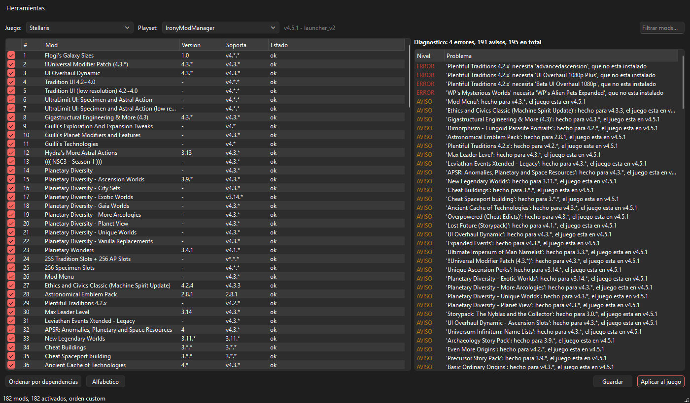

# Loadstone

Gestor de mods y orden de carga para juegos de Paradox: Stellaris, Crusader
Kings III, Victoria 3, Hearts of Iron IV, Europa Universalis IV y V.

El nombre juega con *lodestone*, la piedra iman con la que se orientaban los
navegantes, y con *load order*, que es lo que hay que orientar aqui.

Inspirado en [RimSort](https://github.com/RimSort/RimSort), pero el problema no
es el mismo. En RimWorld los mods declaran `loadAfter` y `loadBefore` y ordenar
es resolver un grafo. En Paradox no existe nada de eso: solo hay
`dependencies`, declaradas por nombre y rara vez, y la regla real es que **el
ultimo mod que carga sobrescribe a los anteriores**. Por eso aqui el orden
automatico es conservador y el valor esta en ver que se solapa con que.

## Estado

v0.1, en desarrollo. Funciona el nucleo y la linea de comandos:

- deteccion de instalaciones y versiones
- lectura de mods cruzando el registro del launcher con el disco
- lectura y escritura de playsets, orden de carga incluido
- diagnostico: entradas colgadas, mods invisibles, versiones incompatibles,
  dependencias ausentes, desactivadas o cargadas en mal orden
- ordenacion por dependencias conservando el orden del usuario
- descarga del Workshop de Steam con SteamCMD, incluidas colecciones enteras,
  e importacion de mods desde una carpeta o un zip
- navegador del Workshop empotrado, con la sesion de Steam iniciada y cola de
  descarga
- busqueda de texto y de rutas dentro de los archivos de los mods
- deteccion de mods desactualizados o retirados del Workshop
- historial de listas de mods, con comparacion y restauracion
- limpieza de descriptores colgados y restos sin descriptor
- desinstalar mods: del disco, del registro y de todos los playsets a la vez
- deteccion de conflictos: que archivos define mas de un mod y cual gana
- gestion de DLC por playset
- arrancar el juego desde la aplicacion
- crear, duplicar, renombrar, borrar, exportar e importar playsets
- notas personales por mod
- interfaz con dos listas, arrastre entre ellas, ficha del mod y diagnostico,
  con menu contextual por mod (abrir carpeta, ver en el Workshop, desinstalar)

Lo que falta: comparar el **contenido** de los archivos en conflicto, no solo
sus rutas, y generar un mod-parche que los fusione.

## Por que, habiendo launcher oficial

El launcher ordena alfabeticamente o a mano, y no dice nada mas. No avisa de
que un mod apunta a una carpeta que ya borraste, ni de que tienes 190 mods
hechos para 4.3 con el juego en 4.5, ni de que un mod declara una dependencia
que no esta instalada. Loadstone empieza por eso.

Hay un precedente excelente, [Irony Mod
Manager](https://github.com/bcssov/IronyModManager), que ademas detecta
conflictos a nivel de objeto y genera un mod-parche. No soporta EU5, que ya
abandono el launcher externo.

## Instalacion

Requiere Python 3.12 o superior.

```bat
python -m venv .venv
.venv\Scripts\activate
pip install -e .[dev]
```

Eso deja dos comandos dentro del entorno: `loadstone` para la linea de
comandos y `loadstone-gui` para la ventana. Sin activar el entorno, se llaman
por su ruta: `.venv\Scripts\loadstone.exe`.

El entorno virtual guarda rutas absolutas, asi que si mueves o renombras la
carpeta del proyecto hay que rehacerlo con los mismos tres comandos.

## Uso

```bash
# que juegos hay, y recordar donde buscar instalaciones fuera de Steam
loadstone games --add-root "D:/Games"

# mods de un juego
loadstone mods --game stellaris --limit 0

# playsets
loadstone playsets --game stellaris

# que esta mal
loadstone check --game stellaris

# reordenar respetando dependencias (simulacion por defecto)
loadstone sort --game stellaris --mode deps
loadstone sort --game stellaris --mode deps --write --apply

# descargar del Workshop e instalar, todo en uno
loadstone workshop --game stellaris 1121692237 --playset "Mi partida"

# instalar un mod que ya tienes descargado
loadstone import --game stellaris "D:/descargas/mimod.zip"

# una coleccion entera, saltando lo que ya tengas
loadstone workshop --game stellaris --collection <url> --missing-only

# que mods tocan el mismo archivo: el origen de casi todos los conflictos
loadstone search --game stellaris "common/governments" --paths

# buscar dentro del contenido, solo en los mods activos
loadstone search --game stellaris "pop_cat_ruler" --scope activos

# que tienes desactualizado respecto al Workshop
loadstone outdated --game stellaris

# instantaneas: se crea una cada vez que aplicas
loadstone history --game stellaris
loadstone history --game stellaris --restore 20261012-0141 --write

# restos en la carpeta mod/ (simulacion por defecto)
loadstone clean --game stellaris --orphans

# que mods se pisan entre si
loadstone conflicts --game stellaris
loadstone conflicts --game stellaris --files    :: por archivo

# DLC
loadstone dlc --game stellaris
loadstone dlc --game stellaris --disable utopia --enable leviathans

# jugar, aplicando antes el playset
loadstone play --game stellaris --apply
```

La interfaz grafica se abre con `loadstone-gui`, con `python -m loadstone`, o
haciendo doble clic en `.venv\Scripts\loadstone-gui.exe`.

`sort` no escribe nada sin `--write`. Con `--apply` ademas lo deja listo para
el juego. `check` devuelve codigo de salida 1 si encuentra errores, para poder
usarlo en scripts.

## Conflictos entre mods

La regla del motor es que **gana el que carga el ultimo**: si dos mods tocan el
mismo archivo, el del final de la lista sustituye al otro por completo.
Loadstone indexa las rutas de todos los mods activos y lista los solapamientos,
con dos vistas: por parejas, para ver de un golpe quien pisa a quien, y por
archivo, para mirar un caso concreto.

El alcance esta acotado a proposito: se comparan **rutas**, no contenidos. Si
dos mods editan el mismo archivo pero tocan cosas distintas, aqui aparece igual,
porque el juego se queda solo con uno de los dos y los cambios del otro se
pierden de todas formas. Distinguir "se pisan de verdad" de "coinciden en el
archivo" exige comparar objeto a objeto, que es el siguiente escalon.

Tambien se tiene en cuenta `replace_path`, que sustituye carpetas enteras y
convierte un solapamiento aparentemente menor en una sustitucion total.

## Los DLC

Cada DLC trae un descriptor en `dlc/<carpeta>/`, en formato Clausewitz (`.dlc`)
o JSON (`.dlc.json`, el de EU5), y su campo `pops_id` es exactamente la clave
con la que la base del launcher los referencia. Comprobado contra una
instalacion real: los 26 DLC que el launcher tenia registrados casan uno a uno
con los 35 encontrados en disco, sin una sola discrepancia.

Lo unico que queda inferido es la forma de las entradas de `disabled_dlcs` en
`dlc_load.json` (`dlc/dlc014_utopia`): no hubo ninguna instalacion con DLC
desactivados contra la que confirmarlo. Si estuviera equivocada, el juego
ignoraria la entrada y cargaria el DLC igualmente.

## Como se detecta que un mod esta desactualizado

Paradox no guarda en ninguna parte de que version del Workshop salio un mod
instalado, asi que no hay un numero que comparar. Loadstone usa dos senales
independientes, consultando la API publica de Steam (sin clave ni cuenta):

1. **El tamano** que publica el Workshop frente a lo que ocupa en disco.
2. **La fecha** de la ultima actualizacion publicada frente a la del archivo
   mas reciente del mod.

Ninguna es concluyente: el tamano cambia si editaste el mod a mano, y las
fechas se pierden al copiar carpetas con herramientas que no las conservan. Por
eso cada resultado dice en que senal se apoya, y existe un margen de 12 horas
para no marcar como viejo un mod que se publico casi a la vez que se instalo.

La consulta tambien detecta los mods **retirados del Workshop**, que es algo
que el launcher no cuenta y que explica por que un mod no recibe arreglos.

## Sobre el Workshop de Steam

`loadstone workshop` usa SteamCMD con `+login anonymous`. Comprobado el
2026-10-12: Stellaris (appid 281990) permite la descarga anonima de contenido
del Workshop, **sin necesidad de poseer el juego en Steam**, asi que funciona
tambien en instalaciones de GOG, de la Microsoft Store o movidas a mano. No se
verifica nada ni se evita ninguna comprobacion: es el comportamiento que Valve
permite para ese appid.

Para los otros cuatro juegos **no funciona de forma anonima**: probados CK3,
Victoria 3, HOI4 y EU4 con items reales de cada uno, todos responden
`Failure`. Ahi hace falta una cuenta que posea el juego:

```bash
loadstone workshop --game ck3 --login TU_USUARIO 3006147147
```

Con cuenta, SteamCMD pide la clave y el codigo de Steam Guard por consola.
El detalle esta medido y documentado en `docs/formatos.md`.

La primera vez descarga el `steamcmd.exe` oficial de Valve a
`%LOCALAPPDATA%/loadstone/steamcmd`. En Linux y macOS hay que instalarlo con el
gestor de paquetes.

Descargar un mod que ya esta registrado **actualiza** su entrada en lugar de
duplicarla, asi que es tambien la via para poner al dia un mod viejo.

## El navegador del Workshop

`Herramientas > Explorar el Workshop` (Ctrl+B) abre el Workshop de Steam
dentro de la aplicacion. No es un enlace al navegador del sistema: es
Chromium empotrado via QtWebEngine, con su propia sesion guardada, asi que se
entra en Steam una vez y despues se navega identificado. Eso es lo unico que
permite ver las suscripciones propias y las colecciones privadas.

Lo que **no** hace es suscribirse ni descargar por su cuenta. De la pagina
solo saca el id del item que se esta mirando; bajarlo sigue siendo cosa de
SteamCMD, igual que `Descargar del Workshop por enlace` (Ctrl+D) y que
`loadstone workshop`. Hay un unico camino por el que entran mods, y es el que
ya estaba probado.

El boton `Anadir a la cola` acepta tanto mods sueltos como colecciones: si lo
que se esta mirando es una coleccion, se expande en los mods que contiene.
Los items retirados del Workshop no se encolan, porque SteamCMD no los puede
bajar y solo serviria para que fallara mas tarde.

Esto cuesta unos 130 MB en el ejecutable, que es el motivo por el que el
proyecto habia evitado WebEngine hasta ahora. Se importa de forma perezosa en
`gui/workshop.py`, asi que quien no abra esa ventana no paga el arranque,
solo el tamano del paquete. Si una instalacion no trae QtWebEngine, el menu
lo dice y remite a la descarga por enlace, que no lo necesita.

## Desinstalar mods

Clic derecho sobre cualquiera de las dos listas: `Abrir la carpeta del mod`,
`Ver en el Workshop` y `Desinstalar`. Con varios mods seleccionados, se
desinstalan todos a la vez.

`cleanup` y `uninstall` resuelven problemas opuestos y conviene no
confundirlos. `Limpiar restos` esta para la basura —descriptores colgados,
registros fantasma, carpetas que el juego ni ve— y por eso **se niega a tocar
nada que algun playset mencione**, aunque este desactivado. `Desinstalar` es
para el mod sano y entero que ya no se quiere: lo saca de los playsets, del
disco y del registro.

El orden de esas tres operaciones no es casual:

1. **Los playsets primero.** Si el contenido desapareciera antes, entre una
   cosa y la otra el launcher veria listas apuntando a un mod inexistente,
   que es justo el estado roto que `Limpiar restos` tiene luego que reparar.
   Si los playsets no se pueden guardar, no se borra nada.
2. **El disco despues**, que es lo unico irreversible.
3. **El registro al final**, porque mientras exista su fila el mod sigue
   teniendo nombre en los mensajes de error.

Un mod suscrito en Steam tiene su contenido fuera de la carpeta del juego.
Por defecto solo se quita el descriptor, que es lo que hace que el juego deje
de verlo; borrar lo de Steam es una casilla aparte, porque mientras siga la
suscripcion Steam lo volvera a descargar.

Los playsets se escriben en el juego al instante: no hace falta pulsar
Guardar despues.

## La marca y el tema

El nombre no era un juego de palabras libre: la *lodestone* es la magnetita, la
piedra naturalmente imantada que sirvio de primera brujula. Para un programa
cuyo oficio es decidir el orden de carga, el simbolo se explicaba solo, y es lo
que dibuja `src/loadstone/gui/assets/loadstone.svg`: una piedra que senala.

Dos decisiones del dibujo, que costaron un intento tirado a la basura:

- La piedra es un poligono **irregular** partido por una sola arista. La forma
  que parece obvia —un hexagono regular con tres caras— sale un cubo
  isometrico: el icono mas repetido del gremio, y encima no es una piedra.
- La aguja es gruesa y llega casi al borde, porque es el unico trazo que
  sobrevive a 16 px. Con las facetas ya fundidas en una mancha, lo que
  distingue el icono en la barra de tareas es esa diagonal clara.

El `.ico` y el `.png` estan en el repositorio, porque un clon tiene que
arrancar sin pasar antes por un paso de compilacion, pero son **derivados y no
se editan a mano**. Despues de tocar el SVG se regeneran con

```bash
.venv\Scripts\python.exe packaging\hacer_icono.py
```

Existe el generador, y no una copia retocada a mano, porque dos versiones de
la misma imagen acaban siempre desincronizadas: alguien retoca el vector y el
ejecutable sigue meses con el icono viejo sin que nadie lo note.

Los colores viven todos en `gui/theme.py`, con nombre de lo que son y no de lo
que valen. **Hay dos esquemas, no uno.** Fijar el oscuro y acabar antes es
tentador —los juegos de Paradox son oscuros—, pero quien tenga Windows en claro
se encontraria una ventana negra entre todas las suyas blancas. Se lee lo que
pide el sistema, y si cambia con la ventana abierta, se vuelve a aplicar.

El acento sale del azul de la aguja. Los colores de diagnostico se mantienen
lejos de el a proposito: si una advertencia pudiera confundirse con un boton,
el diagnostico dejaria de cumplir su unica funcion. Las pruebas comprueban el
contraste de cada combinacion contra el minimo de 4.5:1 de la norma, que es
como se descubrio que el azul del tema claro se quedaba en 4.34 con texto
blanco encima.

## Seguridad de los datos

Loadstone escribe sobre archivos que el juego y el launcher tambien usan, asi
que:

- ninguna escritura ocurre sin copia previa, en `<archivo>.<fecha>.loadstone-backup`
  (se conservan las 5 ultimas)
- los archivos se escriben a un temporal y se renombran encima, para que un
  corte no deje medio archivo
- si la base del launcher esta ocupada, Loadstone se niega a escribir y pide
  cerrar el launcher en lugar de forzar
- `disabled_dlcs` se preserva tal cual: la gestion de DLC no esta implementada

**Cierra el launcher de Paradox antes de escribir.** Si esta abierto, puede
sobrescribir los cambios con lo que tiene en memoria.

## Arquitectura

```
src/loadstone/
  core/                 dominio, sin dependencias de GUI
    clausewitz.py       parser del script de los descriptores
    descriptor.py       lectura de .mod y escaneo de la carpeta mod/
    games.py            registro de juegos y deteccion de instalaciones
    models.py           Mod, Playset, GameProfile
    matching.py         resolucion de dependencias declaradas por nombre
    versions.py         comparacion de versiones al estilo del launcher
    sorting.py          orden de carga
    analysis.py         diagnostico
    config.py           carpetas de busqueda recordadas
    paths.py            donde van configuracion, historial, registro y cache
    atomic.py           escritura que no se queda a medias
    logs.py             registro y captura de fallos
    steamcmd.py         descarga desde el Workshop de Steam
    workshop_api.py     API publica de Steam: versiones y colecciones
    updates.py          deteccion de mods desactualizados
    install.py          instalacion de un mod en la carpeta del juego
    search.py           busqueda dentro de los archivos de los mods
    history.py          instantaneas de la lista de mods
    cleanup.py          restos en la carpeta mod/
    uninstall.py        quitar un mod del disco, del registro y de las listas
    conflicts.py        que archivos define mas de un mod
    dlc.py              los DLC instalados y su estado
    launch.py           arrancar el juego
    notes.py            notas personales por mod
    playsets.py         crear, exportar e importar playsets
    backends/
      base.py           interfaz comun y copias de seguridad
      launcher_v2.py    launcher-v2.sqlite + dlc_load.json
      playsets_json.py  playsets.json del gestor in-game (EU5)
  gui/                  interfaz PySide6
    main_window.py      ventana principal
    widgets.py          las dos listas de mods y la ficha de detalle
    dialogs.py          busqueda, conflictos, DLC, descargas, historial...
    workshop.py         el Workshop empotrado; lo unico que usa QtWebEngine
    tasks.py            trabajo lento fuera del hilo de la interfaz
  cli.py
```

El nucleo no sabe nada de Qt y la GUI no sabe nada de sqlite. Los dos backends
existen desde el primer dia a proposito: la abstraccion correcta es barata
ahora y carisima despues de haber escrito la interfaz contra uno solo.

`docs/formatos.md` documenta los formatos de archivo de Paradox tal y como se
observaron en una instalacion real, incluyendo lo que no se pudo confirmar. Es
la referencia que conviene leer antes de tocar un backend.

## Capturas

En `docs/capturas/`. Se regeneran sin abrir ninguna ventana, renderizando los
widgets con `WA_DontShowOnScreen`.



## Ejecutable independiente

Para usar Loadstone sin instalar Python, como hace RimSort. Hay dos formas y
conviene elegir a conciencia:

```bat
:: Carpeta con los dos ejecutables, arranque instantaneo
pyinstaller packaging/loadstone.spec --noconfirm

:: Un unico .exe que se puede copiar a cualquier parte
pyinstaller packaging/loadstone_gui.py --onefile --windowed ^
    --name Loadstone --paths src --noconfirm --distpath dist/portable
```

| | Carpeta (`loadstone.spec`) | Un solo archivo |
|---|---|---|
| Tamano | 103 MB repartidos | 39 MB en un `.exe` |
| Arranque | ~0,2 s | ~1,4 s |
| Contenido | `Loadstone.exe` y `loadstone-cli.exe` | solo la ventana |
| Para que | uso diario | llevarlo en un USB |

El de un solo archivo pesa menos porque va comprimido, y tarda mas porque se
descomprime en una carpeta temporal en cada arranque.

El `.spec` hace dos analisis pero un unico `COLLECT`, de forma que los dos
ejecutables comparten el runtime de Qt en vez de duplicar sus 60 MB. La version
de linea de comandos excluye PySide6 entero, porque no lo usa.

### Comprobar un paquete recien hecho

Un ejecutable sin consola no cuenta lo que le pasa: si falta un plugin de Qt,
lo unico que se ve es que no abre. Para eso esta `--selftest`, que monta la
ventana sin mostrarla, la cierra sola y responde con el codigo de salida:

```bat
dist\Loadstone\Loadstone.exe --selftest
echo %ERRORLEVEL%
```

### Avisos al distribuirlo

El ejecutable no esta firmado, asi que Windows SmartScreen avisara la primera
vez (*Mas informacion* -> *Ejecutar de todas formas*). Los empaquetados en un
solo archivo tambien suelen dar falsos positivos en algunos antivirus, por como
se descomprimen al arrancar.

## Donde guarda sus cosas

Las rutas las decide `platformdirs`, que sigue la convencion de cada sistema.
En Windows:

| Que | Donde |
|---|---|
| Configuracion | `%APPDATA%/loadstone/config.json` |
| Historial de listas | `%APPDATA%/loadstone/history/` |
| Registro | `%APPDATA%/loadstone/Logs/loadstone.log` |
| SteamCMD y descargas | `%LOCALAPPDATA%/loadstone/Cache/` |

El reparto no es casual: lo que no se puede reconstruir va en datos, y lo que
siempre se puede volver a descargar va en cache.

Definiendo **`LOADSTONE_HOME`** todo eso pasa a colgar de esa unica carpeta,
que es lo que hace falta para llevar Loadstone en un USB junto a su estado.

## Cuando algo falla

Loadstone escribe un registro con rotacion en la ruta de la tabla anterior, y
captura los fallos que nadie preve: en la ventana aparece un aviso con el
detalle y la ruta del registro en lugar de cerrarse sin explicacion. Con
`--debug` se registra todo el detalle.

```bat
dev logs          :: dice donde esta el archivo
loadstone --debug check --game stellaris
```

Esto existe porque la version empaquetada no tiene consola: sin registro, un
fallo ahi es una ventana que no abre y nada mas.

## Tareas de desarrollo

```bat
dev check    :: estilo y pruebas, igual que la integracion continua
dev test
dev fix      :: corrige y formatea lo que se pueda
dev gui      :: abre la aplicacion con registro detallado
dev build    :: genera el ejecutable y lo autocomprueba
```

## Tests

```bash
python -m pytest
```

Los tests no tocan nunca los datos de un juego instalado: construyen una
carpeta de datos y una base sqlite sinteticas en un directorio temporal.

El `conftest.py` ademas garantiza dos cosas, porque romperlas es facil y se
nota tarde: la configuracion real del usuario nunca se lee ni se escribe
(`LOADSTONE_HOME` apunta a un temporal), y **ninguna prueba sale a internet**
salvo que se marque con `@pytest.mark.network`. Sin esa red de seguridad, una
prueba que olvide inyectar los datos de Steam pasaria en una maquina con
conexion y fallaria en la integracion continua.

Las pruebas de interfaz usan `pytest-qt` con la plataforma `offscreen`, asi que
no abren ventanas.
